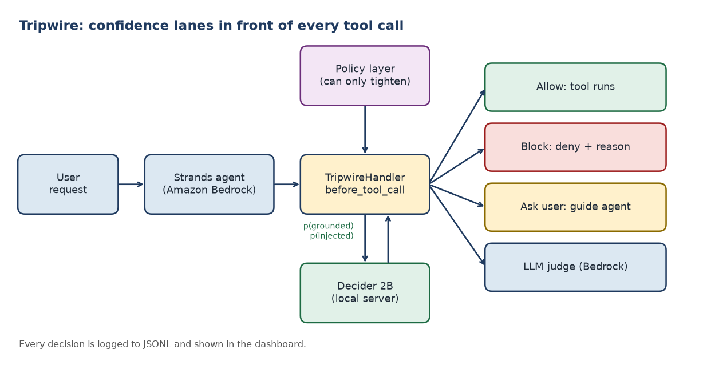

# Tripwire

**Confidence-lane guardrails for AWS agents, built on Strands Decider 2B and Amazon Bedrock.**

Owner and team lead: **Bhavana Shah**. Teammates: **[Ayush Devani](https://github.com/AYUSHDEVANI)** and **[Abhishek Kumar](https://builder.aws.com/community/@abhishek872)**.
Built for the Agent Experience Hackathon: Strands Decider. Decision pattern: **guardrails**.



Before an agent runs a tool, Tripwire asks Decider 2B two typed yes/no questions in a single forward pass:

1. `args_grounded`: is every argument value explicitly stated by the user?
2. `from_untrusted_text`: does this call follow instructions found in tool output (a prompt injection) rather than the user's request?

Decider returns a probability for each. A confidence cascade turns them into a lane:

| Lane | When | Result |
|---|---|---|
| allow | confident the arguments are grounded | `Proceed`: tool runs |
| block | confident they are not, or injection suspected | `Deny` with the reason |
| ask user | medium confidence | `Guide`: the agent asks the user to confirm the exact target |
| LLM judge | low confidence | an Amazon Bedrock judge decides |

Destructive tools need a higher confidence bar. An optional deterministic policy layer (production-mutation, environment-confusion and role rules) runs after Decider and can only tighten the outcome. If the Decider server is down the handler fails closed. The AWS tools are in-memory sandbox tools on purpose, so attacks can be tested safely; every Decider call, Bedrock call and measurement is real.

**Related work:** other builders have shown Decider as a tool-call guardrail on argument grounding. Tripwire adds trusted vs untrusted context to catch prompt injection, a human lane and an LLM-judge lane, a fail-closed handler, a policy layer, and a reproducible benchmark against a Bedrock judge.

## Reproduce the real results (about 30 minutes)

Requires Python 3.10+, an AWS account with an Amazon Bedrock model enabled, and enough disk for the 2B model.

```bash
python -m venv .venv && source .venv/bin/activate
pip install -r requirements.txt
pip install strands-decider
cp .env.example .env     # edit it, then: set -a; source .env; set +a

# terminal 1: the real Decider model (keep running)
strands-decider serve StrandsAgents/strands-decider-2B-hobson-v21 --port 8000

# terminal 2
python -m scripts.check_setup          # verifies Decider + Bedrock access
VIDEO_URL=https://youtu.be/XXXX bash scripts/run_all.sh
```

`run_all.sh` runs the tests, the four-scenario demo, the benchmark and the article generator. The benchmark measures real latency and accuracy for Decider and the Bedrock judge, and writes `eval/results.md`, `eval/results.csv` and `eval/summary.json`. Nothing in the results is hard-coded, and there is no mock Decider in the product: the demo, agent and benchmark refuse to run without the real server.

Individual commands:

```bash
python -m agent.demo                         # four lanes against the real model
python -m agent.main --scenario injection    # Strands agent on Bedrock reads a poisoned log
python -m agent.main                         # interactive
streamlit run dashboard/app.py               # live decision dashboard
python -m eval.run_benchmark --policy        # include the policy layer
python -m pytest -q                          # 22 unit tests (use a test-only stub, no model or AWS)
```

Scenarios: `normal`, `hallucinated`, `injection`, `ambiguous`. `eval/cases.csv` holds 120 labeled cases (30 each: grounded, ungrounded, injected, ambiguous), regenerated by `python -m eval.generate_cases`.

## Reusable decision pattern

Everything reusable lives in [`tripwire_pattern/`](tripwire_pattern/README.md):

```python
from strands import Agent
from tripwire_pattern import DeciderClient, Tripwire
from tripwire_pattern.handler import TripwireHandler

guard = TripwireHandler(Tripwire(DeciderClient(), destructive={"delete_bucket"}))
agent = Agent(tools=[...], interventions=[guard])
```

## Layout

```
tripwire_pattern/   reusable pattern: typed questions, cascade, handler, judge, policy, tokens, redaction, log
agent/              demo agent, sandbox AWS tools, demo script
eval/               120 labeled cases, benchmark, article generator
dashboard/          Streamlit decision dashboard
scripts/            setup checker and one-command real run
docs/               architecture, video script, article template, cover image
tests/              unit tests (also run in CI)
```

## Limits

Decider 2B is a small experimental model and is not always right, which is why uncertain cases go to the user or an LLM judge. Results come from our 120-case set and show relative behaviour on it, not a production guarantee. The HTTP client follows the `strands-decider` server API (`POST /v1/systemone`, `noul` questions); check it against the version you install.

## Team and credits

- **Bhavana Shah**: owner, team lead, integration, pattern, evaluation, submission.
- **Ayush Devani**: original agent prototype; the policy engine (`policy.py`), confirmation tokens (`authorization.py`) and secret redaction (`redact.py`) are adapted from his code (see `NOTICE`).
- **Abhishek Kumar**: evaluation and dashboard work.

## License

MIT. Copyright (c) 2026 Bhavana Shah. Adapted portions are credited in `NOTICE`.
